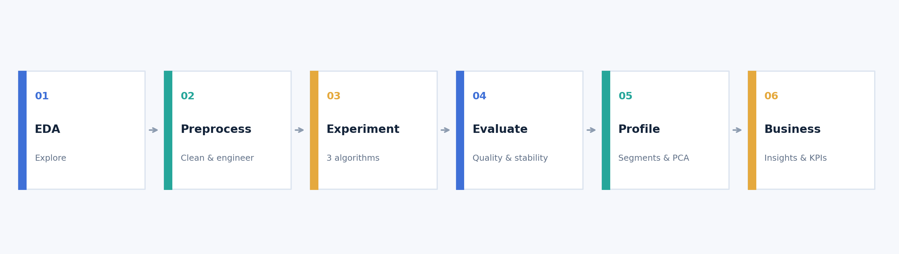
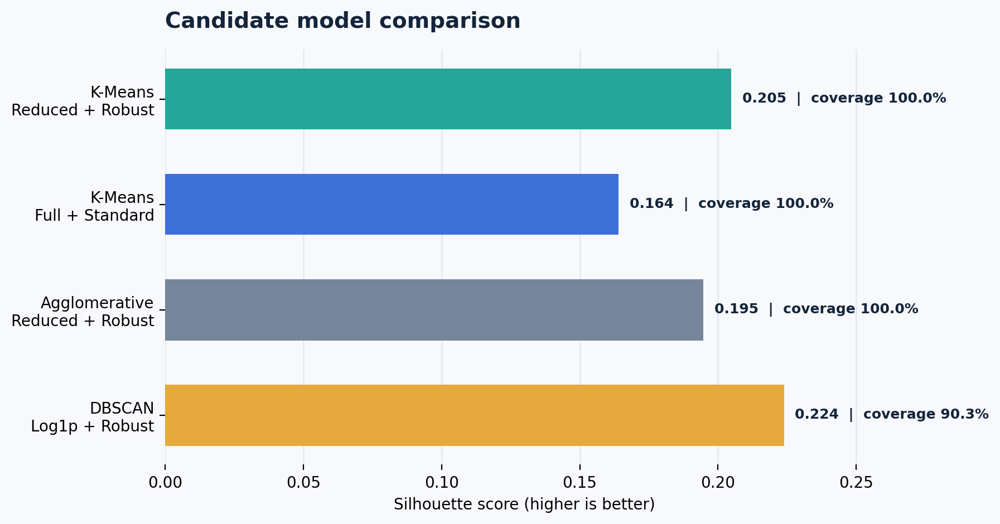
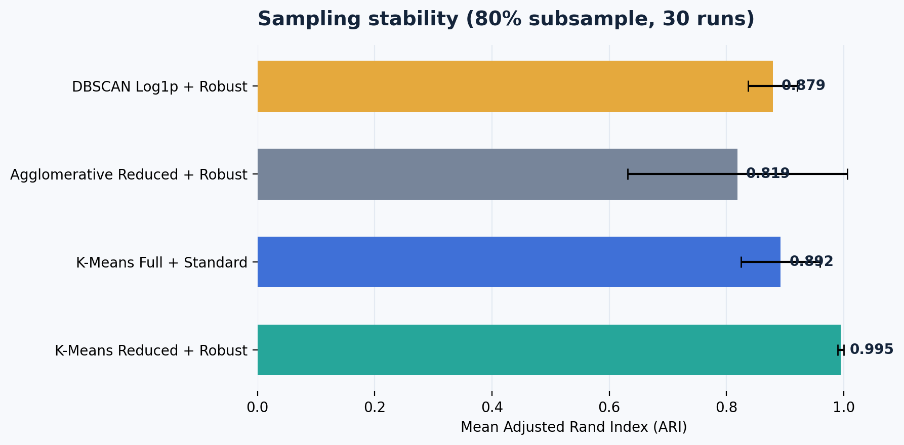
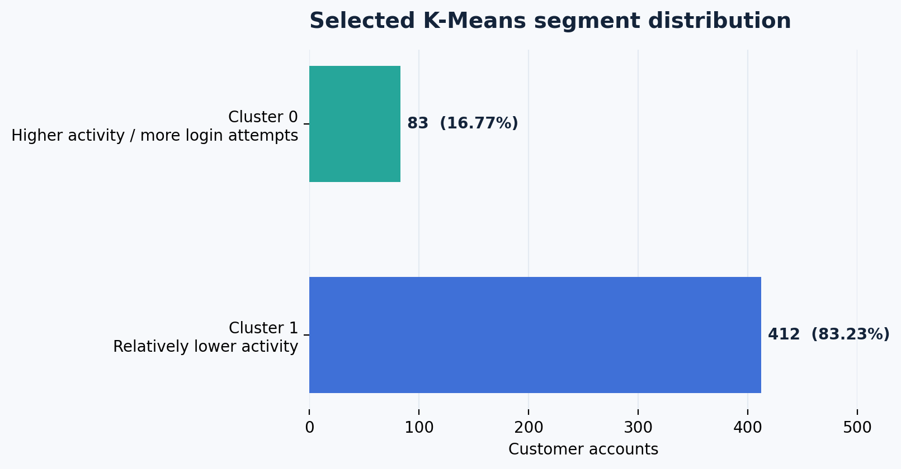
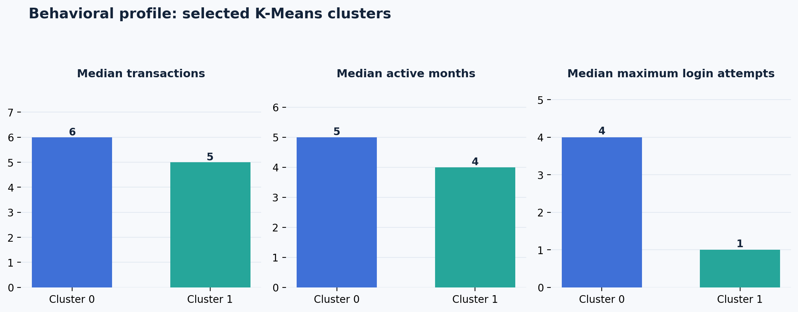
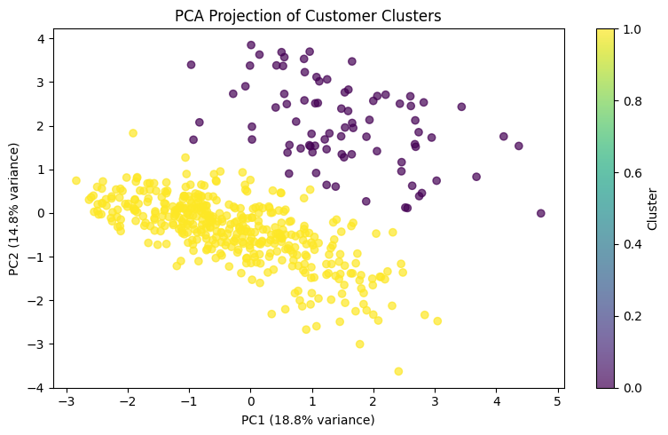
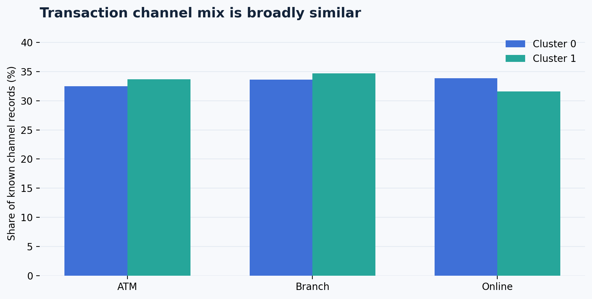

# Customer Transaction Behavior Segmentation Using Machine Learning

An end-to-end Data Science and Unsupervised Machine Learning portfolio project that explores customer-level transaction behavior, compares clustering algorithms, profiles resulting segments, and translates observed patterns into testable business recommendations.



> **Research boundary:** This is an exploratory segmentation study. The clusters are not validated credit-risk, fraud, churn, profitability, or customer-value labels and should not be used as the sole basis for decisions affecting individual customers.

## Project at a glance

| Item | Result |
|---|---:|
| Customer accounts in selected model | **495** |
| Cleaned transaction rows | **2,513** |
| Transactions linked to an AccountID | **2,493** |
| Transactions without an AccountID | **20** |
| Initial customer-level features | **29** |
| Reduced feature representation | **18** |
| Algorithms evaluated | **K-Means, Agglomerative Clustering, DBSCAN** |
| Selected configuration | **K-Means · C_Reduced18_Robust · k=2** |
| Selected-model Silhouette score | **0.2048** |
| Selected-model customer coverage | **100%** |
| Selected-model noise points | **0** |

## Key findings

The selected K-Means model produces two behaviorally different groups:

| Segment | Accounts | Share | Median transactions | Median active months | Median max login attempts |
|---|---:|---:|---:|---:|---:|
| Cluster 0 — relatively higher activity and more login attempts | 83 | 16.77% | 6 | 5 | 4 |
| Cluster 1 — relatively lower activity | 412 | 83.23% | 5 | 4 | 1 |

- Cluster 0 records more transaction activity and more active months in the observation period.
- The average transaction amount and average account balance are very similar across clusters; the groups should not be interpreted as high-value versus low-value customers.
- ATM, Branch, and Online channel proportions are broadly similar across clusters.
- Higher recorded login attempts in Cluster 0 warrant a review of authentication experience and login telemetry, **not a fraud conclusion**.

### Model evaluation and stability

DBSCAN's selected candidate achieved the highest Silhouette score (0.2239), but it labeled 48 of 495 accounts as noise (9.70%) and produced a smallest cluster of only four accounts. K-Means `C_Reduced18_Robust` was therefore selected for profiling because it had the best Silhouette score among candidates covering all 495 accounts (0.2048), no noise labels, and stronger stability.

- Random-seed stability: mean ARI **1.0000** across 30 K-Means runs.
- Sampling stability: mean ARI **0.9950** across 30 runs using 80% subsamples.
- PCA visualization: the first two components explain **33.61%** of the variance; the plot is illustrative and does not show the full 18-dimensional structure.

## Visual results

### Candidate model comparison



### Sampling stability



### Selected cluster distribution



### Behavioral profile



### PCA projection



### Transaction channel mix



## Research workflow

| Stage | Focus | Main output |
|---|---|---|
| 1. Exploratory Data Analysis | Dataset overview, missingness, duplicates, statistics, outliers, categorical/temporal patterns, customer structure | EDA findings |
| 2. Data Cleaning & Preprocessing | Cleaning, validation, account-level aggregation, feature engineering, feature selection | Customer-level feature matrix |
| 3. Model Experimentation | Feature representations, scaling, Log1p, K-Means, Agglomerative, DBSCAN | Model experiment results |
| 4. Model Evaluation & Comparison | Internal metrics, cluster coverage, cluster distribution, reproducibility, seed and sampling stability | Selected candidate |
| 5. Cluster Profiling | Descriptive/statistical comparison, PCA, channel and transaction-type mix, cluster labels | Segment profiles |
| 6. Business Interpretation & Recommendations | Behavior insights, implications, recommendations, KPIs, limitations | Testable business hypotheses |

## Repository structure

```text
.
├── README.md
├── README_ID.md
├── requirements.txt
├── .gitignore
├── notebooks/
│   ├── 01_Data_Exploration_and_Preprocessing.ipynb
│   └── 02_Machine_Learning_and_Business_Insights.ipynb
├── data/
│   └── README.md
├── results/
│   ├── modeling/       # aggregate model metrics and stability results
│   ├── profiling/      # aggregate segment profiles and feature tests
│   └── business/       # insights, recommendations, proposed KPIs, limitations
├── figures/            # publication-ready aggregate charts
├── presentation/       # research presentation decks
└── docs/
    └── METHODOLOGY.md
```

## How to run

The notebooks were authored for **Google Colab** and use interactive file uploads. Run them in order:

1. Open `notebooks/01_Data_Exploration_and_Preprocessing.ipynb` in Google Colab.
2. Upload the source transaction dataset that you are legally permitted to use. Run all cells. The notebook exports `cleaned_transaction_dataset.csv`, `customer_level_features_audit.csv`, and `customer_features_for_clustering_unscaled.csv`.
3. Open `notebooks/02_Machine_Learning_and_Business_Insights.ipynb` in a new Colab session.
4. When prompted at the beginning, upload **all three** exported files from Notebook 1. The first validation checks the two customer-level files; the cleaned transaction file is required later for Stage 5.
5. Run all cells sequentially. Stage 3 and Stage 4 create their output folders; Stages 5 and 6 read these generated files and export profiling/business tables.

For a local Jupyter environment, install the packages in `requirements.txt`. The notebooks contain Google Colab upload cells; those cells need a small local file-loading adjustment before running outside Colab.

## Interpretation and limitations

- The selected model's Silhouette score (**0.2048**) indicates limited cluster separation; some customer profiles may overlap.
- Cluster sizes are imbalanced (83 versus 412 accounts).
- 20 transaction rows have no AccountID and cannot be assigned to a segment.
- Among assigned transactions, 27 Channel and 30 TransactionType values are missing.
- Recorded age and occupation are inconsistent for many accounts; these attributes are excluded from segment naming and demographic interpretation.
- Direct outcomes such as churn, profitability, customer satisfaction, fraud labels, and campaign results are unavailable.
- The two-dimensional PCA view explains 33.61% of the feature variance and is not a complete representation of the model space.
- Feature comparisons are descriptive support rather than independent external validation because the features also contribute to clustering.

Business recommendations are therefore framed as hypotheses to validate with controlled pilots, operational telemetry, and appropriate outcome data.

## Tech stack

Python · pandas · NumPy · Matplotlib · Seaborn · SciPy · scikit-learn · Jupyter Notebook · Google Colab

## Presentation

- [English research presentation](presentation/Customer_Transaction_Behavior_Segmentation_EN.pptx)
- [Indonesian research presentation](presentation/Customer_Transaction_Behavior_Segmentation_ID.pptx)

Both decks include speaker notes.

## Data and licensing

Customer-level datasets and raw transaction records are intentionally excluded from this public repository. See [`data/README.md`](data/README.md) before adding any dataset. No software license has been selected in this package; add a license only after confirming ownership and redistribution rights for the code and data.

For an Indonesian overview, see [README_ID.md](README_ID.md).
